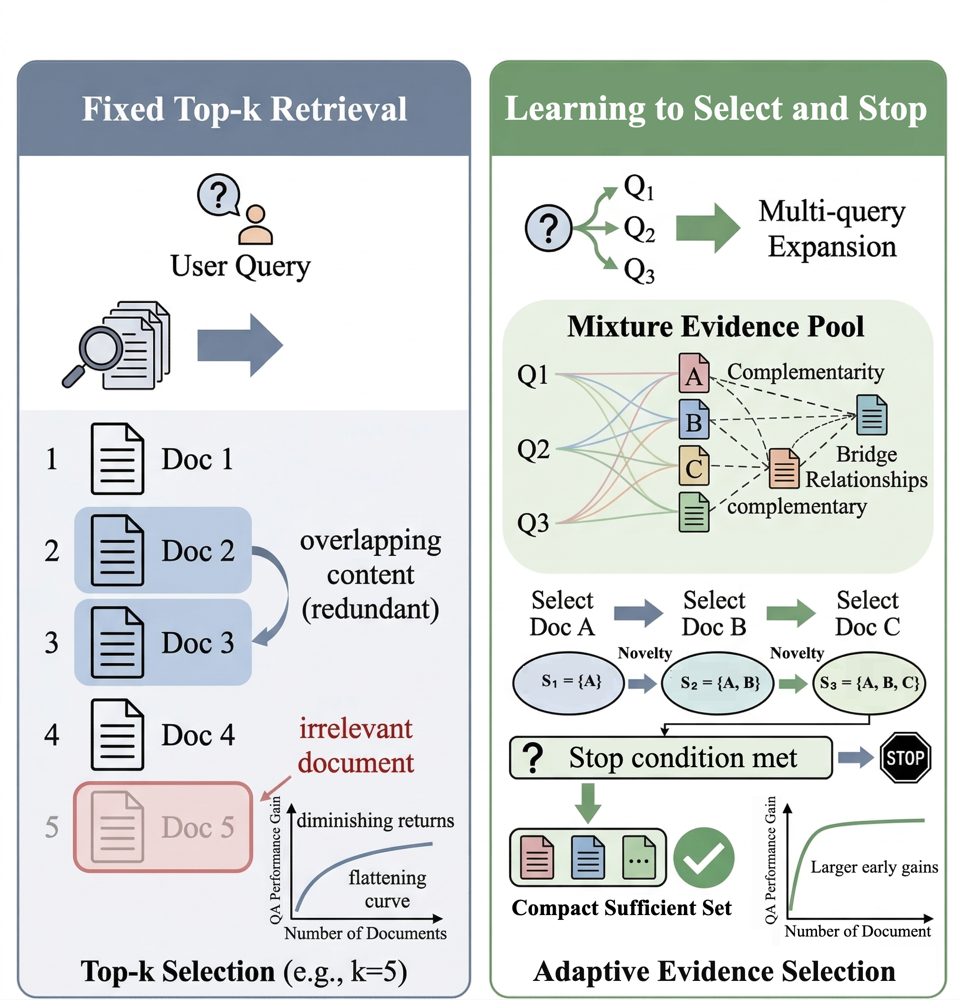
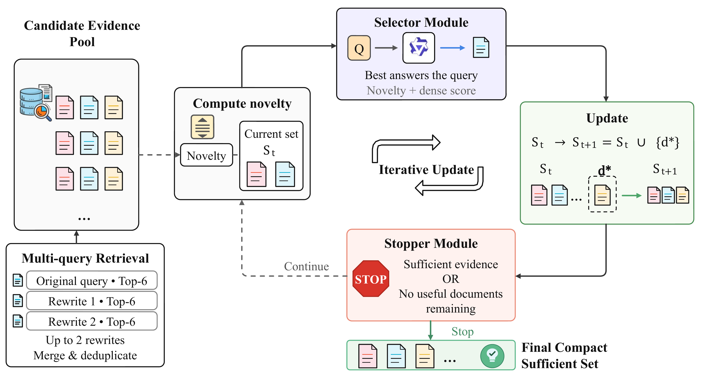
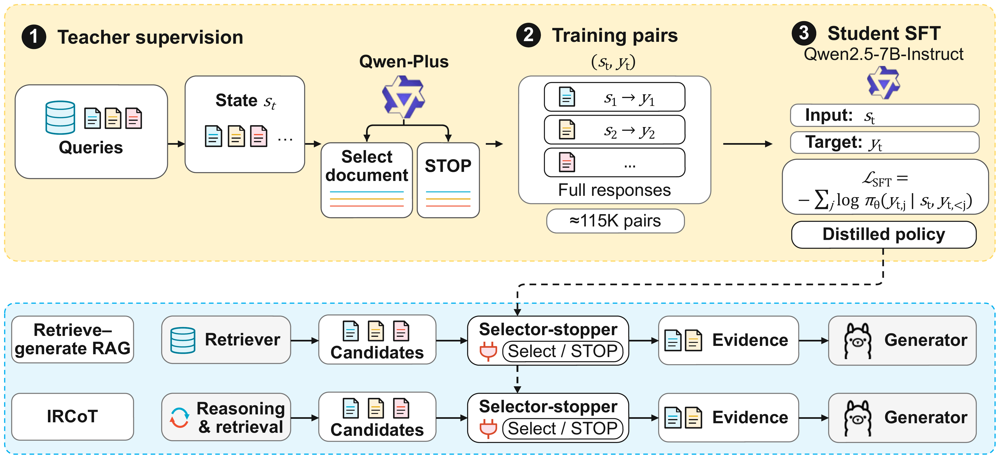

<h1 align="center">IGRAG</h1>

<h3 align="center">
  Guided Selection and Adaptive Stopping<br>
  for Compact Evidence in Retrieval-Augmented Generation
</h3>

<p align="center">
  Zhicheng Zhang, Yuchen Yao, Wentao Zhou, Wenhui Liu,<br>
  Jinran Sun, Haohao Lu, Lei Cao, and Jie Li
</p>

<p align="center">
  <a href="https://github.com/leyanLT/IGRAG"></a>
  <a href="#requirements"></a>
  <a href="LICENSE"></a>
</p>

<p align="center"><em>Select useful evidence. Stop when sufficient.</em></p>

<p align="center">
  <a href="#overview">Overview</a> &nbsp;·&nbsp;
  <a href="#results">Results</a> &nbsp;·&nbsp;
  <a href="#installation">Installation</a> &nbsp;·&nbsp;
  <a href="#data-preparation">Data</a> &nbsp;·&nbsp;
  <a href="#train-evidence-stop-model">Training</a> &nbsp;·&nbsp;
  <a href="#run-igrag-evaluation">Evaluation</a> &nbsp;·&nbsp;
  <a href="#citation">Citation</a>
</p>

<p align="center">
  <a href="assets/figure-1.png"></a>
  <br>
  <sub>Fixed top-k retrieval and adaptive evidence selection in IGRAG.</sub>
</p>

## Overview

**Information-Guided Retrieval-Augmented Generation (IGRAG)** constructs compact evidence sets through guided document selection and adaptive stopping. Given a multi-query candidate pool, a distilled selector-stopper uses the query, accumulated evidence, remaining candidates, and auxiliary retrieval and novelty signals to select the next document or stop. Novelty is an embedding-based non-redundancy signal; QA performance gain is measured retrospectively for evaluation and is not an input to the policy.

This repository contains the reproduction code accompanying the latest submission manuscript and supplementary material.

## Results

### QA performance and evidence efficiency

Main IGRAG-SFT results reported in the paper:

| Dataset | EM ↑ | F1 ↑ | Accuracy ↑ | Avg. #Docs ↓ |
| --- | ---: | ---: | ---: | ---: |
| NQ | 39.80 | **52.36** | - | **2.80** |
| HotpotQA | 33.10 | **45.78** | - | **3.56** |
| 2WikiMultiHopQA | 20.00 | **30.65** | - | **3.87** |
| MultiHopRAG | - | - | **62.30** | **2.94** |

The paper reports an overall **Avg. #Docs of 3.36**. Against the strongest evaluated budget-controlled baseline for each metric, IGRAG-SFT improves F1 by 0.47, 2.22, and 2.50 percentage points on NQ, HotpotQA, and 2WikiMultiHopQA, respectively, and accuracy by 0.70 points on MultiHopRAG.

### Transfer to IRCoT

The paper also evaluates transferring the selector-stopper to IRCoT-generated candidates:

| Dataset | Method | EM ↑ | F1 ↑ | Avg. #Docs ↓ |
| --- | --- | ---: | ---: | ---: |
| HotpotQA | IRCoT | 29.10 | 39.02 | 15.50 |
| HotpotQA | IRCoT-Stopper | **36.50** | **48.73** | **7.29** |
| 2WikiMultiHopQA | IRCoT | 19.20 | 27.75 | 9.17 |
| 2WikiMultiHopQA | IRCoT-Stopper | **23.27** | **33.92** | **5.41** |

These are reported paper results. The runnable entry points below cover the main IGRAG pipeline.

## Method

<p align="center">
  <a href="assets/figure-2.png"></a>
  <br>
  <sub>Figure 2. Multi-query retrieval, novelty-aware evidence selection, and adaptive stopping.</sub>
</p>

IGRAG is implemented on top of [FlashRAG](https://github.com/RUC-NLPIR/FlashRAG). The reproduction contains two high-level stages:

<details>
<summary><strong>View the training and inference pipeline</strong></summary>

```text
distilled neural selector-stopper policy
  Qwen-Plus teacher trajectories
  -> 115,655 structured state-response supervision instances
  -> LoRA fine-tuning of Qwen2.5-7B-Instruct
  -> local OpenAI-compatible selector-stopper service

IGRAG inference
  input query
  -> structured query expansion: original query + up to 2 reformulations
  -> dense retrieval: top-6 per branch, at most 18 candidates before deduplication
  -> multi-query mixture evidence pool construction
       deduplicate documents and keep branch provenance, hit count, branch rank, and dense score
  -> novelty-aware incremental evidence selection
       select useful evidence conditioned on the current evidence set
  -> sufficiency-aware dynamic stopping
       stop when evidence is sufficient or no remaining candidate can fill a critical gap
  -> answer generation with the compact sufficient evidence set
  -> QA/retrieval evaluation, optional evidence-prefix QA gain and average-k analysis
```

</details>

This repository is packaged as an IGRAG paper reproduction codebase. The `flashrag/` package is retained because IGRAG extends FlashRAG components for dataset loading, retrieval, generation, and evaluation. New IGRAG-specific logic is mainly implemented in the pipeline hooks, query rewriting, multi-query mixture evidence pool construction, neural selector-stopper, training scripts, and analysis scripts.

The paper describes the policy through document-selection and `STOP` actions. The current implementation invokes next-document selection and sufficiency judgment as separate endpoint calls, using the two prompt types in Supplementary Section I. Count both calls when measuring online tokens and latency.

### Entry points

| Script | Dataset | Purpose |
| --- | --- | --- |
| `run_igrag.py` | NQ / HotpotQA / 2WikiMultiHopQA | Run IGRAG on FlashRAG-format Wiki QA benchmarks. |
| `run_igrag-mul.py` | MultiHopRAG | Run IGRAG after downloading and converting MultiHopRAG. |
| `scripts/train_evidence_stop_lora.py` | Provided SFT data | Fine-tune the evidence selection/stop model with LoRA. |
| `scripts/check_evidence_stop_endpoint.py` | Local endpoint    | Smoke test the OpenAI-compatible evidence-stop server. |
| `generate_information_gain_curve.py` | Evaluation output | Evaluate QA gain over available evidence prefixes. |
| `generate_average_k_plot.py` | Evaluation output | Generate the average selected evidence count. |

## Requirements

Recommended environment:

- Python 3.11
- CUDA-capable GPU for generator inference and LoRA fine-tuning
- `faiss-cpu` or `faiss-gpu` for dense retrieval indexes
- `transformers`, `peft`, and `torch` for LoRA training
- `vllm` for OpenAI-compatible local serving
- An OpenAI-compatible API key for query rewriting, such as DashScope `qwen-turbo`

The default reproduction configuration uses:

| Component | Default model in scripts | Notes |
| --- | --- | --- |
| Retriever | `BAAI/bge-large-en-v1.5` | Use `cls` pooling. Build a matching FAISS index. |
| Generator | `Llama-3.1-8B-Instruct` | Used by `run_igrag.py` and `run_igrag-mul.py`. |
| Query rewriter | `qwen-turbo` | Called through an OpenAI-compatible API. |
| Evidence selector/stopper | `qwen2.5-evidence-stop-sft` | A LoRA adapter fine-tuned from `Qwen2.5-7B-Instruct` with the provided SFT data, then served locally. |

## Installation

Create and activate the conda environment:

```bash
conda create -n igrag python=3.11 -y
conda activate igrag
```

Upgrade the Python packaging tools:

```bash
python -m pip install -U pip setuptools wheel
```

Install vLLM with a PyTorch/CUDA combination supported by your GPU and driver. Follow the [official vLLM GPU installation guide](https://docs.vllm.ai/en/stable/getting_started/installation/gpu/) when choosing versions. For a supported prebuilt environment:

```bash
python -m pip install vllm
```

Install the remaining project dependencies and Faiss:

```bash
pip install -r requirements.txt
pip install faiss-cpu
pip check
```

Run all commands from the repository root. If Python cannot find the local `flashrag` package, set:

```bash
export PYTHONPATH="$PWD:$PYTHONPATH"
```

## Data Preparation

### HotpotQA, 2WikiMultiHopQA, and NQ

For these three benchmarks, use the **preprocessed FlashRAG version** instead of downloading the raw original datasets. IGRAG expects the FlashRAG JSONL schema, so the recommended source is the official FlashRAG dataset repository: [RUC-NLPIR/FlashRAG_datasets](https://huggingface.co/datasets/RUC-NLPIR/FlashRAG_datasets).

FlashRAG provides:

- `nq/train.jsonl`, `nq/dev.jsonl`, `nq/test.jsonl`
- `hotpotqa/train.jsonl`, `hotpotqa/dev.jsonl`
- `2wikimultihopqa/train.jsonl`, `2wikimultihopqa/dev.jsonl`
- `retrieval-corpus/wiki18_100w.zip`

Install the Hugging Face Hub CLI if it is not available:

```bash
pip install -U huggingface_hub
```

Download the QA datasets from FlashRAG:

```bash
mkdir -p /root/autodl-tmp/FlashRAG_Data

hf download RUC-NLPIR/FlashRAG_datasets \
  --repo-type dataset \
  --local-dir /root/autodl-tmp/FlashRAG_Data \
  --include "nq/*.jsonl" "hotpotqa/*.jsonl" "2wikimultihopqa/*.jsonl"
```

Download and extract the FlashRAG Wikipedia retrieval corpus:

```bash
hf download RUC-NLPIR/FlashRAG_datasets \
  --repo-type dataset \
  --local-dir /root/autodl-tmp/FlashRAG_Data \
  --include "retrieval-corpus/wiki18_100w.zip"

cd /root/autodl-tmp/FlashRAG_Data/retrieval-corpus
unzip wiki18_100w.zip
cd -
```

After downloading, the expected layout is:

```text
/root/autodl-tmp/FlashRAG_Data/
  nq/
    train.jsonl
    dev.jsonl
    test.jsonl
  hotpotqa/
    train.jsonl
    dev.jsonl
  2wikimultihopqa/
    train.jsonl
    dev.jsonl
  retrieval-corpus/
    wiki18_100w.jsonl
```

If Hugging Face is slow or unavailable in your environment, still use the same FlashRAG files through a Hugging Face mirror, or manually download them from the [FlashRAG dataset page](https://huggingface.co/datasets/RUC-NLPIR/FlashRAG_datasets). Do not mix these preprocessed files with raw HotpotQA, raw 2WikiMultiHopQA, or raw NQ files unless you convert them to the FlashRAG schema first.

### MultiHopRAG

Download `MultiHopRAG.json` and `corpus.json` from the [official MultiHop-RAG repository](https://github.com/yixuantt/MultiHop-RAG), placing both files in one directory. The QA data and corpus are not bundled in this checkout. Convert the release files with:

```bash
python scripts/prepare_multihoprag.py \
  --dataset-dir /path/to/original/MultiHopRAG \
  --output-dir /root/autodl-tmp/FlashRAG_Data/MultiHopRAG \
  --split dev
```

The command produces `dev.jsonl` and `corpus.jsonl`. The paper uses 609 news documents without further chunking. The expected QA format is:

```json
{"id": "0", "question": "...", "golden_answers": ["..."], "metadata": {}}
```

The expected corpus format is:

```json
{"id": "0", "contents": "...", "title": "...", "source": "..."}
```

### Path Configuration

After downloading HotpotQA, 2WikiMultiHopQA, NQ, and the Wikipedia corpus, update the paths in `run_igrag.py` and any dataset-specific experiment script:

Important: the paths currently written in `run_igrag.py` and `run_igrag-mul.py` are reference paths from the author's local environment. They are not portable defaults. Before running the scripts, replace `data_dir`, `corpus_path`, `index_path`, and every entry in `model2path` with the actual paths on your machine.

```text
/path/to/FlashRAG_Data/
  nq/
    train.jsonl
    dev.jsonl
    test.jsonl
  hotpotqa/
    train.jsonl
    dev.jsonl
  2wikimultihopqa/
    train.jsonl
    dev.jsonl
  retrieval-corpus/
    wiki18_100w.jsonl
  indexes/
    bge_large_en_wiki18_100w_sharded/
```

The scripts assume FlashRAG-style fields: `question`, `golden_answers`, and a JSONL retrieval corpus with `id` and `contents`.

## Build Retrieval Index

IGRAG uses `BAAI/bge-large-en-v1.5` in the provided scripts. Build the FAISS index with the same retriever and pooling method used during evaluation.

### Wiki18 Index for HotpotQA, 2WikiMultiHopQA, and NQ

HotpotQA, 2WikiMultiHopQA, and NQ use the FlashRAG Wikipedia retrieval corpus `retrieval-corpus/wiki18_100w.jsonl`. Build a BGE Large index for this corpus:

```bash
CUDA_VISIBLE_DEVICES=0 python -m flashrag.retriever.index_builder \
  --retrieval_method bge-large-en-v1.5 \
  --model_path /root/autodl-tmp/models/BAAI/bge-large-en-v1.5 \
  --corpus_path /root/autodl-tmp/FlashRAG_Data/retrieval-corpus/wiki18_100w.jsonl \
  --save_dir /root/autodl-tmp/FlashRAG_Data/indexes/bge_large_en_wiki18_100w \
  --use_fp16 \
  --max_length 512 \
  --batch_size 256 \
  --pooling_method cls \
  --faiss_type Flat \
  --save_embedding
```

After indexing, update the corresponding experiment script:

```python
"corpus_path": "/root/autodl-tmp/FlashRAG_Data/retrieval-corpus/wiki18_100w.jsonl",
"index_path": "/root/autodl-tmp/FlashRAG_Data/indexes/bge_large_en_wiki18_100w/bge-large-en-v1.5_Flat.index",
```

Use this Wiki18 index for HotpotQA, 2WikiMultiHopQA, and NQ experiments. The paper uses sharded CPU exact inner-product search for Wikipedia. To build shards, add `--flat_shard_size` with a positive number of documents per shard and set `index_path` to the output directory. This option changes storage layout, not the exact-search objective. MultiHopRAG uses a single index.

### MultiHopRAG Index

Example for the converted MultiHopRAG corpus:

```bash
CUDA_VISIBLE_DEVICES=0 python -m flashrag.retriever.index_builder \
  --retrieval_method bge-large-en-v1.5 \
  --model_path /path/to/BAAI/bge-large-en-v1.5 \
  --corpus_path /root/autodl-tmp/FlashRAG_Data/MultiHopRAG/corpus.jsonl \
  --save_dir /path/to/indexes/MultiHopRAG_bge_large \
  --use_fp16 \
  --max_length 512 \
  --batch_size 256 \
  --pooling_method cls \
  --faiss_type Flat \
  --save_embedding
```

Then update the following fields in `run_igrag-mul.py`:

```python
"data_dir": "/root/autodl-tmp/FlashRAG_Data",
"corpus_path": "/root/autodl-tmp/FlashRAG_Data/MultiHopRAG/corpus.jsonl",
"index_path": "/path/to/indexes/MultiHopRAG_bge_large/bge-large-en-v1.5_Flat.index",
"model2path": {
    "bge-large-en-v1.5": "/path/to/BAAI/bge-large-en-v1.5",
    "llama-3.1-8b-instruct": "/path/to/Llama-3.1-8B-Instruct",
},
```

Important: do not reuse an index built with another embedding model. The index must be built with `bge-large-en-v1.5` if you keep the default retrieval configuration.

## Train Evidence-Stop Model

The evidence-stop model used by IGRAG is **not trained from scratch**. It is a LoRA fine-tuned model based on `Qwen2.5-7B-Instruct`.

Use the original `Qwen2.5-7B-Instruct` checkpoint as `--model-path`, and save only the LoRA adapter to `--output-dir`. During evaluation, this adapter is served together with the same base model under the OpenAI-compatible model name `qwen2.5-evidence-stop-sft`.

<p align="center">
  <a href="assets/figure-3.png"></a>
  <br>
  <sub>Figure 3. Teacher-supervised distillation and integration into retrieve–generate RAG and IRCoT.</sub>
</p>

The full evidence selection/stop training archive is included in the repository:

```text
scripts/train_data/train_data_all.jsonl.zip
```

Unzip it before training:

```bash
cd scripts/train_data
unzip train_data_all.jsonl.zip
cd ../..
```

Use `scripts/train_data/train_data_all.jsonl` for the full reproduction after extraction. It contains 115,655 SFT instances distilled from Qwen-Plus teacher trajectories on the training splits of HotpotQA, 2WikiMultiHopQA, and MuSiQue:

| Source split | Instances |
| --- | ---: |
| HotpotQA train | 37,382 |
| 2WikiMultiHopQA train | 50,011 |
| MuSiQue train | 28,262 |

The archive contains 58,275 `select_candidate` and 57,380 `judge_stop` instances. The complete structured assistant response is supervised. Teacher prompts do not receive gold answers or supporting facts. Examples are grouped by `(dataset_name, split, item_id)` and partitioned 85:10:5 into training, validation, and held-out test subsets with seed 2024; examples from one question stay together. Source benchmark validation/test questions are excluded from distillation.

The paper's small-data ablation requires a separately prepared subset; that subset is not included in this checkout.

Full LoRA fine-tuning uses five RTX 5090 GPUs in the paper setting. Pass the following options explicitly: the training script's defaults differ from the paper configuration. Replace the model and output paths with your local paths:

```bash
PYTORCH_ALLOC_CONF=expandable_segments:True \
CUDA_VISIBLE_DEVICES=0,1,2,3,4 torchrun --nproc_per_node 5 scripts/train_evidence_stop_lora.py \
  --data-path scripts/train_data/train_data_all.jsonl \
  --model-path /root/autodl-tmp/models/Qwen/Qwen2.5-7B-Instruct \
  --output-dir /root/autodl-tmp/models/Qwen/Qwen2.5-7B-Instruct-evidence-stop-lora-full \
  --seed 2024 \
  --max-seq-length 3072 \
  --train-ratio 0.85 \
  --valid-ratio 0.1 \
  --num-train-epochs 1.5 \
  --per-device-train-batch-size 1 \
  --per-device-eval-batch-size 1 \
  --gradient-accumulation-steps 8 \
  --learning-rate 8e-5 \
  --warmup-ratio 0.03 \
  --eval-steps 500 \
  --save-steps 500 \
  --logging-steps 10 \
  --lora-r 16 \
  --lora-alpha 32 \
  --lora-dropout 0.05 \
  --tokenization-stats-sample-size 1000
```

This configuration uses BF16, gradient checkpointing, AdamW with zero weight decay, a linear learning-rate schedule, and an effective batch size of 40. LoRA targets the attention and feed-forward projections (`q_proj`, `k_proj`, `v_proj`, `o_proj`, `gate_proj`, `up_proj`, and `down_proj`). Use the final adapter for evaluation. A pretrained IGRAG adapter is not bundled; train it before serving.

The training script saves:

```text
/path/to/qwen2.5-evidence-stop-lora/
  adapter_config.json
  adapter_model.safetensors
  data_splits/
    train.jsonl
    valid.jsonl
    test.jsonl
    stats.json
```

## Serve Evidence-Stop Model

The IGRAG evaluation scripts call the evidence-stop model through an OpenAI-compatible API endpoint. Serve the `Qwen2.5-7B-Instruct` base model with the trained LoRA adapter, and expose it as `qwen2.5-evidence-stop-sft`.

A common vLLM serving command is:

```bash
CUDA_VISIBLE_DEVICES=1 vllm serve /root/autodl-tmp/models/Qwen/Qwen2.5-7B-Instruct \
  --enable-lora \
  --lora-modules qwen2.5-evidence-stop-sft=/root/autodl-tmp/models/Qwen/Qwen2.5-7B-Instruct-evidence-stop-lora-full \
  --host 127.0.0.1 \
  --port 8001 \
  --dtype bfloat16 \
  --max-model-len 8192 \
  --gpu-memory-utilization 0.85 \
  --max-lora-rank 64 \
  --trust-remote-code
```

Check the local endpoint:

```bash
python scripts/check_evidence_stop_endpoint.py \
  --base-url http://127.0.0.1:8001/v1 \
  --model qwen2.5-evidence-stop-sft
```

Expected final line:

```text
Evidence stopper endpoint smoke test passed.
```

## Run IGRAG Evaluation

Before running evaluation, check `run_igrag.py` and `run_igrag-mul.py` carefully. The hard-coded paths in these files are examples only and must be changed to your own dataset, corpus, index, generator model, retriever model, and evidence-stop endpoint paths.

### API key for query rewriting

Query rewriting uses `qwen-turbo` through an OpenAI-compatible API. In both run scripts, first set `query_rewrite_setting["api_key"]` to `None` and keep `api_key_env` as `"DASHSCOPE_API_KEY"`. An explicit key in the configuration takes precedence over the environment variable. Then export your key:

```bash
export DASHSCOPE_API_KEY="your_api_key_here"
```

Keep provider keys out of committed code and shared experiment outputs. Replace any key previously exposed in a public copy.

### Dataset and evaluation settings

The paper evaluates seeded samples, with `random_sample=True` and `seed=2024`:

| Dataset | Entry point | `dataset_name` | `split` | `test_sample_num` | QA metrics |
| --- | --- | --- | --- | ---: | --- |
| NQ | `run_igrag.py` | `nq` | `test` | 1,000 | EM, F1 |
| HotpotQA | `run_igrag.py` | `hotpotqa` | `dev` | 1,000 | EM, F1 |
| 2WikiMultiHopQA | `run_igrag.py` | `2wikimultihopqa` | `dev` | 1,500 | EM, F1 |
| MultiHopRAG | `run_igrag-mul.py` | `MultiHopRAG` | `dev` | 1,000 | Accuracy |

In `run_igrag.py`, edit the corresponding fields in `config_dict` before each dataset run. It defaults to HotpotQA; `run_igrag-mul.py` defaults to MultiHopRAG. Both scripts use `split=["dev"]` by default; change it to `["test"]` for NQ. The run scripts use configuration dictionaries rather than dataset command-line arguments.

After preparing data, building the index, and starting the selector-stopper endpoint, run the appropriate command from the repository root:

```bash
# NQ, HotpotQA, or 2WikiMultiHopQA, after updating config_dict
python run_igrag.py

# MultiHopRAG, after updating local paths
python run_igrag-mul.py
```

Shared settings in the run scripts are:

| Component | Setting |
| --- | --- |
| Query expansion | Qwen-Turbo; original query plus at most **2** reformulations |
| Branch retrieval | Top-6 per branch; at most **18** candidates before deduplication |
| Evidence pool | Deduplicated by identifier/content; keeps branch provenance, hit count, rank, and dense score |
| Initial pool order | Descending hit count, descending maximum dense score, ascending best rank |
| Paper's average deduplicated pool | 11.49 documents |
| Retriever | BGE Large English v1.5; CLS pooling; normalized embeddings; FP16 |
| Retrieval query length / batch size | 128 tokens / 256 |
| Selector-stopper | `qwen2.5-evidence-stop-sft`; candidate content capped at 800 characters |
| Generator | Llama-3.1-8B-Instruct through vLLM; greedy decoding |
| Generator input / output limits | 2,048 / 64 tokens |
| Base/fallback retrieval budget | Top-5; separate from Top-6 per expanded-query branch |
| Analysis switches | `enable_average_k_plot=True`; `enable_information_gain_curve=False` |

For an additional full-split experiment, set `test_sample_num=None` and `random_sample=False`. This changes the evaluation set from the samples reported in the paper.

## Outputs and Plots

Each run creates a timestamped directory under `output/`. Plot files depend on the analysis switches:

```text
output/{dataset_name}_{YYYY_MM_DD_HH_MM}_{save_note}/
  config.yaml
  metric_score.txt
  intermediate_data.json
  igrag_information_gain_{f1_or_acc}.csv   # optional; disabled by default
  igrag_information_gain_{f1_or_acc}.json  # optional
  igrag_information_gain_{f1_or_acc}.png   # optional
  igrag_average_k.csv                     # enabled by default
  igrag_average_k.json
  igrag_average_k.png
```

Main outputs:

- `metric_score.txt`: aggregate EM/F1/ACC and retrieval metrics.
- `intermediate_data.json`: predictions, retrieved documents, evidence pools, selected evidence, and evidence selection traces.
- `igrag_information_gain_*.csv/json/png`: optional QA performance gain over available evidence prefixes; filenames retain the original `information_gain` naming.
- `igrag_average_k.csv`: compact summary with `avg_k` and `valid_sample_count`.
- `igrag_average_k.json`: the same average-k summary plus the source field definition.
- `igrag_average_k.png`: single-value plot of the average selected evidence count `k`.

The plotting switch in the experiment scripts is `enable_average_k_plot`, and the generated file stem is `igrag_average_k`.

The generated `config.yaml` is important for reproducibility because it records the resolved model paths, dataset paths, retrieval settings, and generation settings.

### Evidence-prefix QA performance gain

Main Section V-A and Supplementary Section IV analyze the gain relative to no retrieval on the same questions with the same generator:

```text
G_D(k) = 100 × [Q_D(k) − Q_D(0)]    (percentage points)
```

Here, `Q_D(k)` is the average QA score on a 0–1 scale using the first `k` documents in the method's evidence order. The paper uses F1 for NQ, HotpotQA, and 2WikiMultiHopQA, and accuracy for MultiHopRAG, over `k=0,...,10`. For selector-stopper configurations, the paper's controlled analysis forces selection beyond natural `STOP` to obtain longer prefixes. Normal inference follows the learned stopping decision.

The current plotting helper evaluates only the available document sequence. With `doc_source="selected_evidence"` and `short_evidence_policy="hold"`, it holds the last prefix's score when `k` exceeds the selected evidence count; it does not force additional selection. Enabling `enable_information_gain_curve` therefore produces a diagnostic of the normal selected prefixes. To reproduce the paper's forced-continuation curves, obtain the continued evidence sequences separately before prefix evaluation. The exported `avg_cumulative_ig` is on the 0–1 score scale; multiply by 100 to express it in the paper's percentage-point units.

The supplementary material also provides the selection/sufficiency prompts (Section I), retrieval-quality results on NQ, 2WikiMultiHopQA, and MultiHopRAG (Section II), the quality–efficiency comparison (Section III), and distillation/generalization analysis with a qualitative query-embedding t-SNE visualization (Section V). The t-SNE projection complements the QA and ablation results; it is not a quantitative generalization metric.

## Reproducibility Notes

- Keep the retriever model, pooling method, and index consistent. The default is `bge-large-en-v1.5` with `cls` pooling.
- Use the same generator model revision when comparing with paper results.
- Record GPU type, CUDA version, PyTorch version, vLLM version, and model checkpoints.
- Match the paper's sample counts, splits, and seed in the evaluation table above; record the sampled question IDs.
- The evidence-stop endpoint must be running before `run_igrag.py` or `run_igrag-mul.py`.
- Query rewriting depends on an external OpenAI-compatible service. API failures fall back only if `failure_policy` is set to `fallback`.
- `scripts/generate_evidence_stop_train_data.py` is provided for regenerating SFT data, but the released reproduction path uses the included files under `scripts/train_data/`.

## Repository Layout

```text
IGRAG/
  assets/
    figure-1.png
    figure-2.png
    figure-3.png
  run_igrag.py
  run_igrag-mul.py
  flashrag/
    pipeline/
      pipeline.py
      query_rewrite.py
      evidence_pool.py
      evidence_selection_stop.py
  scripts/
    train_data/
      train_data_all.jsonl.zip
      train_data_all.jsonl      # created after extraction; ignored by Git
    train_evidence_stop_lora.py
    check_evidence_stop_endpoint.py
    prepare_multihoprag.py
  generate_information_gain_curve.py
  generate_average_k_plot.py
```

## Citation

Please cite the IGRAG paper when using this reproduction code:

```bibtex
@misc{zhang2026igrag,
  title  = {{IGRAG}: Guided Selection and Adaptive Stopping for Compact Evidence in Retrieval-Augmented Generation},
  author = {Zhang, Zhicheng and Yao, Yuchen and Zhou, Wentao and Liu, Wenhui and Sun, Jinran and Lu, Haohao and Cao, Lei and Li, Jie},
  year   = {2026},
  note   = {Manuscript},
  url    = {https://github.com/leyanLT/IGRAG}
}
```

This repository is built on FlashRAG. Please also cite FlashRAG:

```bibtex
@inproceedings{jin2025flashrag,
  title     = {{FlashRAG}: A Modular Toolkit for Efficient Retrieval-Augmented Generation Research},
  author    = {Jin, Jiajie and Zhu, Yutao and Dou, Zhicheng and Dong, Guanting and Yang, Xinyu and Zhang, Chenghao and Zhao, Tong and Yang, Zhao and Wen, Ji-Rong},
  booktitle = {Companion Proceedings of the ACM on Web Conference 2025},
  pages     = {737--740},
  year      = {2025},
  doi       = {10.1145/3701716.3715313}
}
```

## License

See [LICENSE](LICENSE).
